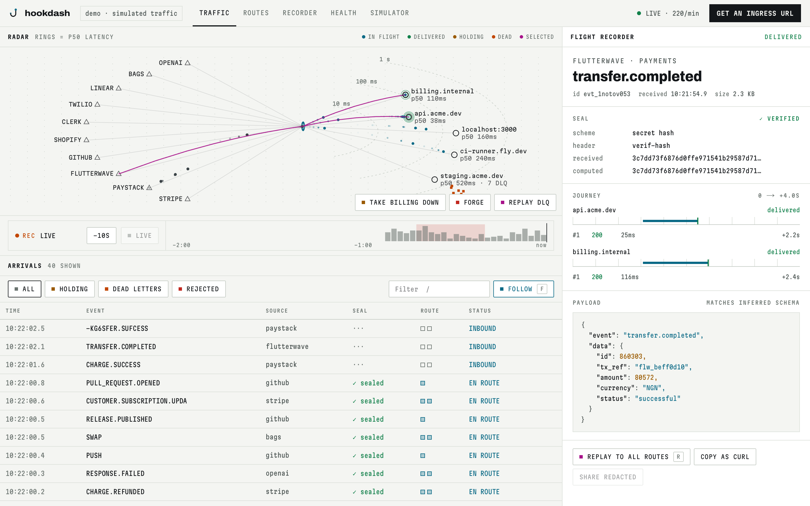
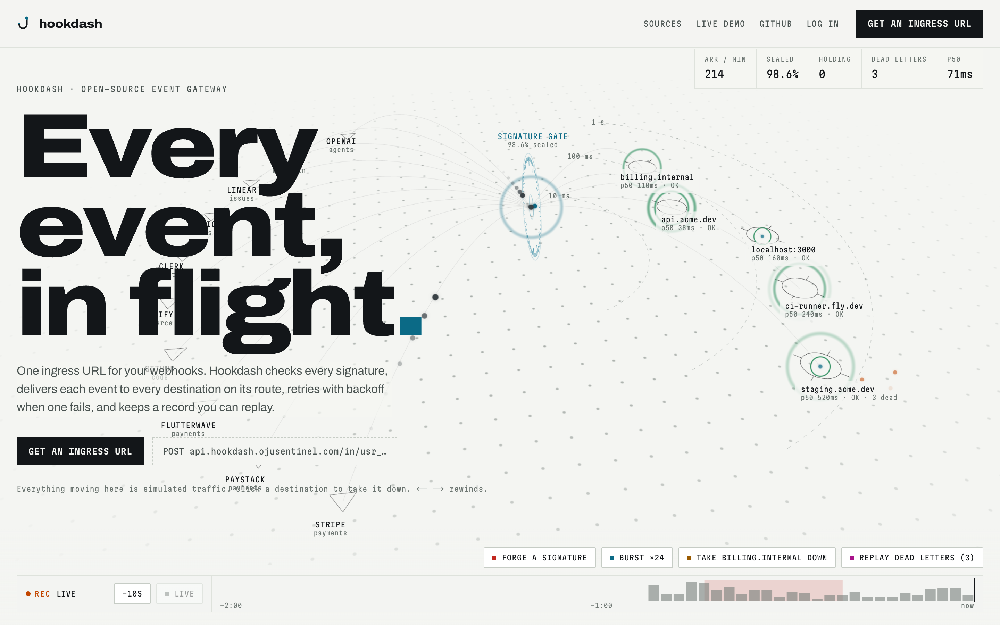

# Hookdash

**Webhook gateway for payment providers.** One ingress URL for all your webhooks. Hookdash verifies every provider's signature, delivers each event to every destination on its route with its own retries and dead letters, re-signs it with Standard Webhooks headers, and keeps a record you can replay.

**[Live app](https://hookdash.ojusentinel.com)** · **[Demo with simulated traffic](https://hookdash.ojusentinel.com/demo)** · API: `https://api.hookdash.ojusentinel.com`



NestJS 11 · PostgreSQL · BullMQ/Redis · Socket.io · Next.js 16. Verifies Stripe, Paystack, Flutterwave, Mono, GitHub, Shopify, Slack, Linear, Twilio and any Standard Webhooks sender out of the box. Self-hosted on a VPS behind nginx with TLS.

<details>
<summary>Landing page</summary>



</details>

## What it does

Hookdash generates a unique ingress URL per workspace. Point your provider's webhook settings at it and every incoming event is:

- **Captured** — headers, raw body, signature, IP, everything
- **Verified** — provider-specific signature validation (see supported providers below)
- **Transformed** — configurable rules to mutate or reshape the payload before forwarding
- **Forwarded** — relayed to your local or staging server via a BullMQ queue with dead-letter capture for failed deliveries
- **Signed** — every forwarded request carries Standard Webhooks headers (`webhook-id`, `webhook-timestamp`, `webhook-signature`) from your route's `whsec_` secret, so your server verifies one scheme whatever the provider (`verify.hookdash()` in the SDK)
- **Streamed** — pushed to the dashboard over WebSocket in real time
- **Alerted** — Slack, Discord, or Email notifications on matching events

No more `ngrok` + `console.log` guesswork.

## Supported providers

| Provider | Signature verification |
|----------|----------------------|
| Stripe | HMAC-SHA256 hex over `t.body`, 5 min timestamp tolerance |
| Paystack | HMAC-SHA512 hex |
| Flutterwave | Secret hash in `verif-hash` |
| Mono | Secret in `mono-webhook-secret` |
| Bags.fm | HMAC-SHA256 hex (WebSocket stream for Solana token launch events) |
| GitHub | HMAC-SHA256 hex in `X-Hub-Signature-256` (`sha256=`); event from `X-GitHub-Event` |
| Shopify | HMAC-SHA256 base64 in `X-Shopify-Hmac-Sha256`; topic from `X-Shopify-Topic` |
| Slack | HMAC-SHA256 hex over `v0:timestamp:body` in `X-Slack-Signature`, 5 min tolerance; answers `url_verification` challenges |
| Linear | HMAC-SHA256 hex in `Linear-Signature`; `webhookTimestamp` within 60 s |
| Twilio | HMAC-SHA1 base64 over URL + sorted params in `X-Twilio-Signature`; `bodySHA256` check for JSON bodies |
| Standard Webhooks (Clerk, Resend, OpenAI, any Svix sender) | HMAC-SHA256 base64 over `id.timestamp.body`, `whsec_` secret, `webhook-*` or `svix-*` headers, 5 min tolerance |
| Custom | HMAC-SHA256 hex in `X-Webhook-Signature` if sent, otherwise unverified |

Each provider is a declarative recipe in `api/src/modules/signature/recipes.ts`.

## Architecture

```
                     ┌──────────────┐
  Provider ──POST──▶ │   Ingress    │──▶ PostgreSQL (events)
  (Paystack,         │  /in/:slug   │──▶ BullMQ (forward queue)
   Flutterwave,      └──────────────┘──▶ WebSocket (live push)
   Mono, Stripe,            │
   Bags.fm, etc.)           ▼
                     ┌──────────────┐
                     │   Forward    │──POST──▶ Your server
                     │   Worker     │         (with dead-letter queue)
                     └──────────────┘
```

```
hookdash/
├── api/          NestJS 11 backend
├── web/          Next.js 16 frontend
├── sdk/          TypeScript SDK
├── cli/          CLI tool
└── docker-compose.yml
```

## Features

- **Multi-provider signature verification** — each provider's exact spec, including Stripe's timestamp + replay attack prevention
- **Bags.fm integration** — WebSocket stream for Solana token launch events, filterable by creator, initial buy amount, and symbol pattern
- **Payload transforms** — configurable rules to mutate or reshape webhook bodies before forwarding
- **Per-destination delivery** — each destination is its own job with its own retries and backoff, so a slow or failing receiver never delays the others; attempts record real stage timings (parsed, queued, sent, responded)
- **Dead letter queue** — failed forwards are captured per destination and retryable
- **Alerting** — Slack, Discord, and Email notifications
- **Workspace management** — multi-tenant, team-friendly
- **API keys** — key-based auth alongside JWT
- **Event diff** — compare two events side by side
- **Test payloads** — send synthetic events without a live provider
- **Retention policies** — configurable event TTL
- **SDK & CLI** — programmatic and terminal access

## CLI

Forward live webhooks to your machine while you develop:

```bash
cd cli && npm install && npm run build && npm link

hookdash login                     # email and password
hookdash login --api-key hd_live_… # Google/GitHub accounts and CI (create a key in Settings)
hookdash listen --port 3000 --path /webhooks
```

`listen` delivers the exact bytes Hookdash received, with the provider's own headers, so your local signature checks pass. Each result is reported back and shows in the dashboard's flight recorder as `cli · localhost:3000/webhooks`. After a dropped connection it catches up on anything it missed, and `--since 10m` replays the last ten minutes on start. `--endpoint <id>` limits it to one endpoint, and `--forward-to <url>` sends somewhere other than localhost.

Also: `hookdash endpoints`, `hookdash events [--status failed]`, `hookdash replay <event-id>`, `hookdash whoami`.

## Tech stack

| Layer | Tech |
|-------|------|
| API | NestJS 11, TypeORM, PostgreSQL, BullMQ, Redis, Socket.io, Passport JWT |
| Web | Next.js 16, React 19, Tailwind CSS 4, GSAP, Socket.io Client |
| Infra | Docker Compose (Postgres 16, Redis 7) |

## Getting started

### Prerequisites

- Node.js 20+
- Docker & Docker Compose

### 1. Start infrastructure

```bash
docker compose up -d postgres redis
```

### 2. Start the API

```bash
cd api
cp .env.example .env
npm install
npm run start:dev       # http://localhost:3000
```

### 3. Start the frontend

```bash
cd web
npm install
npm run dev             # http://localhost:3001
```

### 4. Use it

1. Open `http://localhost:3001` and create an account
2. Create an **endpoint** (a source) to configure forwarding and signature verification
3. Each endpoint gets its own ingress URL like `http://localhost:3000/in/src_…`. Set it as the webhook URL in the provider
4. The older per-account URL (`/in/usr_…`) still works and routes by provider header
5. Send a test webhook — it appears on the Live Stream page instantly

## API routes

| Method | Route | Description |
|--------|-------|-------------|
| `POST` | `/api/auth/signup` | Create account |
| `POST` | `/api/auth/login` | Get JWT token |
| `POST` | `/in/:slug` | Webhook ingress (public) |
| `GET` | `/api/events` | List events (paginated, filterable) |
| `GET` | `/api/events/:id` | Event detail |
| `POST` | `/api/events/:id/replay` | Replay an event |
| `GET` | `/api/events/:id/diff/:otherId` | Diff two events |
| `GET/POST/PATCH/DELETE` | `/api/endpoints` | Endpoint CRUD |
| `GET/POST/PATCH/DELETE` | `/api/transform` | Transform rule CRUD |
| `GET/POST/PATCH/DELETE` | `/api/alerting` | Alert rule CRUD |
| `GET` | `/api/dead-letter` | Failed forward queue |
| `POST` | `/api/dead-letter/:id/retry` | Retry failed forward |
| `GET` | `/api/stats` | Analytics (24h, 7d, 30d, all) |
| `GET` | `/api/health` | Health check |

## Environment variables

```bash
# api/.env
DB_HOST=localhost
DB_PORT=5433
DB_USERNAME=hookdash
DB_PASSWORD=hookdash_secret
DB_NAME=hookdash
REDIS_HOST=localhost
REDIS_PORT=6380
JWT_SECRET=dev-jwt-secret-change-in-production
JWT_EXPIRY=7d
PORT=3000
NODE_ENV=development
```

## License

[MIT](LICENSE) © 2026 Joseph Olayanju
